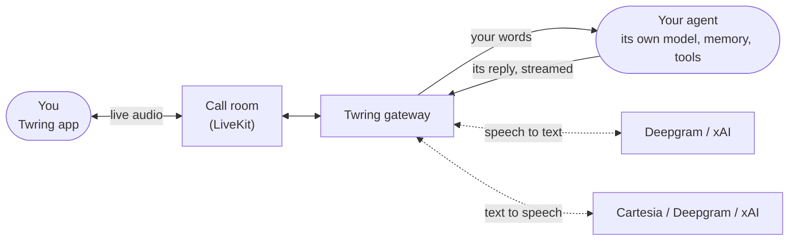

<div align="center">


# Twring

### Bring any agent brain. Get the voice.

Call the AI agents you already run from your phone, and let them call you back.<br>
Your agent keeps its own model, memory and tools. Twring adds the call.

[](LICENSE.md)
[](https://twring.com)
[](https://twring.com/self-hosting/)
[](tsconfig.base.json)
[-19D6F2?style=flat-square&labelColor=05070A)](CONTRIBUTING.md)

[**Website**](https://twring.com) &nbsp;·&nbsp;
[**Run your own server**](https://twring.com/self-hosting/) &nbsp;·&nbsp;
[**Connect an AI app**](https://twring.com/connector/) &nbsp;·&nbsp;
[**Docs**](docs/README.md) &nbsp;·&nbsp;
[**Discussions**](https://github.com/saasagelabs/twring/discussions)

<br>

<a href="https://twring.com/media/twring-in-30-seconds.mp4">
  
</a>

<sub>Twring in 30 seconds. Click for the full film.</sub>

</div>

<br>

## Why Twring

Your agents are working. Why are you still watching them?

|  |  |
| --- | --- |
| **Talk to the agent you already run** | Press Call and talk to Hermes, Claude Code, Codex, Gemini CLI or any agent with its own web address. Same agent, same memory, same tools. |
| **It rings you when it matters** | When a job is done or needs your OK, your agent rings your phone, even when it is locked. |
| **A real call, not voice notes** | Streaming speech both ways, natural turn-taking, and you can interrupt at any moment. |
| **You stay in control** | Approvals arrive as a question on the call. Say yes or no, or tap. Twring never runs your agent's tools for it. |

## How it works



Voice is input and output, not intelligence. Twring turns your speech into text for your agent and its reply into speech for you, handles turn-taking and interruptions, and keeps the call alive across network changes. Everything your agent decides and does stays with your agent.

## Get started

<details open>
<summary><b>Use Twring's service</b> &nbsp;(nothing to run)</summary>

<br>

1. Get an invite at [twring.com](https://twring.com) and install the app (iPhone through TestFlight, Android from the download link).
2. Sign in, then connect your agent: the app shows the one command to run on the computer where your agent lives.
3. Press **Call**.

</details>

<details>
<summary><b>Bring your own speech account</b> &nbsp;(Deepgram, Cartesia or xAI)</summary>

<br>

Use Twring's service with your own speech provider: in the app, open **Settings, AI apps, Your own voice accounts** and add your key. Twring checks it with the provider before saving, keeps it encrypted on the server, and never puts it in the app.

</details>

<details>
<summary><b>Run your own server</b> &nbsp;(one command)</summary>

<br>

Run Twring next to your agents on your own Linux machine or VPS, with your own speech account:

```sh
curl -fsSL https://twring.com/install.sh | sudo sh
```

Then pair the app by scanning the code it shows. Your chats and files stay on your server. The full guide: [twring.com/self-hosting/guide](https://twring.com/self-hosting/guide/).

</details>

<details>
<summary><b>Connect Claude, ChatGPT or another AI app</b></summary>

<br>

AI chat apps can't take calls, but they can ring you and message you in Twring. Add Twring as a custom connector in the app's settings: the steps are at [twring.com/connector](https://twring.com/connector/).

</details>

## Works with

**Agents:** Hermes, Claude Code, Codex, Gemini CLI, and any agent you can reach at its own web address.<br>
**AI apps:** Claude, ChatGPT and other apps that accept a custom connector.<br>
**Speech:** Deepgram, Cartesia and xAI (Grok voices).<br>
**Phones:** iPhone and Android, built from one React Native codebase.

## Built on these rules

- **Voice is I/O, not intelligence.** The connected agent does the thinking.
- **Twring never calls your agent's tools.** Your agent calls its own.
- **No provider secret in the app.** Keys stay on the server.
- **Streaming by default.** Partial speech drives the screen; the agent's text is spoken as it arrives.
- **Interruptions come first.** When you speak over your agent, its voice stops at once.

The full set, and every decision behind it, is in [docs/DECISIONS.md](docs/DECISIONS.md).

## What is in this repository

<details>
<summary>Repository map</summary>

<br>

| Folder | What it is |
| --- | --- |
| [`apps/gateway`](apps/gateway) | The server: calls, agents, chats, rings, self-hosted mode |
| [`apps/relay`](apps/relay) | The ring relay that wakes a locked phone for self-hosted servers |
| [`apps/mobile`](apps/mobile) | The phone app (Expo, React Native) |
| [`apps/connector`](apps/connector) | The tool that links an agent's computer to Twring |
| [`apps/site`](apps/site) | twring.com |
| [`deploy/selfhost`](deploy/selfhost) | The self-host kit: installer, `twring` command, compose files |
| [`packages/`](packages) | Shared contracts, config, agent adapters and push |
| [`skills/twring`](skills/twring) | The agent skill: how an agent behaves on a Twring call |
| [`docs/`](docs) | Product, architecture, voice, security and decisions |

</details>

<details>
<summary>Develop</summary>

<br>

```sh
corepack enable
pnpm install
pnpm typecheck && pnpm lint && pnpm test
```

Start with [CLAUDE.md](CLAUDE.md) and [docs/ARCHITECTURE.md](docs/ARCHITECTURE.md). Setup, keys and device testing: [docs/DEVELOPMENT.md](docs/DEVELOPMENT.md).

</details>

## Contributing

Questions and ideas are welcome in [Discussions](https://github.com/saasagelabs/twring/discussions). Found a bug? [Open an issue](https://github.com/saasagelabs/twring/issues/new/choose). Pull requests are welcome too: read [CONTRIBUTING.md](CONTRIBUTING.md) first. Every commit needs a sign-off (`git commit -s`).

Found a security problem? Please don't open an issue: see [SECURITY.md](SECURITY.md).

## License

The server, relay and self-host kit are AGPL-3.0; the app, the computer tool and everything else are Apache-2.0. Details: [LICENSE.md](LICENSE.md). The Twring name and logo: [TRADEMARKS.md](TRADEMARKS.md).

<div align="center">
<br>
<sub>Made by <a href="https://github.com/saasagelabs">SaaSage Labs</a> &nbsp;·&nbsp; <a href="https://twring.com">twring.com</a> &nbsp;·&nbsp; <a href="mailto:hello@twring.com">hello@twring.com</a></sub>
</div>
