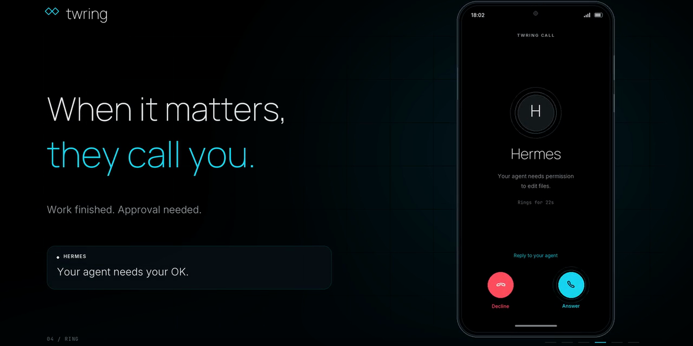

# Twring for Hermes



**Call your Hermes. Hermes calls you.**

Twring is a phone app (iPhone and Android) for the AI agents you already run. This plugin makes Twring a Hermes messaging platform, like Telegram, except you can also **talk**:

- **Live two-way calls.** Press Call in the Twring app and talk to your own Hermes. Twring turns your speech into text, Hermes streams its answer, and Twring speaks it as it arrives. Talk over Hermes at any time: its voice stops at once and its work carries on. When you go on to ask something new, Twring replaces the old turn, Hermes stops that run (as if you typed `/stop`) and answers what you just said. Hang up instead, and Hermes keeps working.
- **Calls and chat in one conversation.** Typed messages in the Twring app and spoken turns on a call reach the same Hermes conversation.
- **Approvals by voice or tap.** When Hermes needs your OK for a risky command, the request appears on your phone. Say "yes" or "no", or tap. The answer goes back through Hermes's own approval system: the plugin never approves anything for you, and silence means no.
- **It rings you back.** When a scheduled Hermes job delivers to `twring`, its result lands in your Twring chat and your phone rings with the first sentence. Hang up while Hermes is still working, and the rest of its answer reaches your chat, with a ring if your Twring settings allow.

Hermes keeps its own model, memory, tools and permissions. Twring adds the call.

## Set up (3 steps)

1. Install the Twring app from [twring.com](https://twring.com) and sign in.
2. Link this Hermes to it:

   ```sh
   hermes plugins install twring
   hermes twring link
   ```

   In the app, tap **Add agent**, **On my computer or server**, and scan the code (or type it).

3. Start the gateway so your phone can reach Hermes:

   ```sh
   hermes gateway
   ```

That's it: **Hermes** now appears in the Twring app. Press Call.

`hermes gateway setup` offers the same link step. `hermes twring status` shows whether you're linked, and `hermes twring unlink` forgets the link on this computer (then delete Hermes in the app too).

### Ring me when a scheduled job finishes

Deliver any Hermes cron job to `twring`. Its result is saved in your Twring chat and your phone rings with its first sentence (at most 140 characters). Set `TWRING_RING_ON_DELIVERY=false` for a notification instead of a ring.

### Use one link, not two

If you already use Twring's `twring-connect` program for Hermes on this computer, stop it before linking the plugin. Otherwise the app shows two "Hermes" agents, and the two programs take the same link from each other.

### Your own Twring server

Self-host Twring? Link to it with `hermes twring link --server https://your-twring-server`.

## Settings

| Variable | What it does |
| --- | --- |
| `TWRING_TOKEN` | This computer's link token. Saved by `hermes twring link`; never printed |
| `TWRING_SERVER` | Twring server, default `https://api.twring.com` |
| `TWRING_ALLOWED_USERS` | `owner` (the linked Twring account), set by `link` |
| `TWRING_HOME_CHANNEL` | Where scheduled-job results go: `owner`, set by `link` |
| `TWRING_RING_ON_DELIVERY` | Ring for scheduled-job results (`true` by default) |

## What this plugin does on your computer (disclosure)

- **Network:** one outbound WebSocket to your Twring server (`wss://api.twring.com/v1/connectors/socket` by default) while `hermes gateway` runs, plus HTTPS calls to the same server to link, to post scheduled-job results to your chat and to ring your phone. Nothing else is contacted. Redirects are refused, and the token only travels in an `Authorization` header to the server you linked.
- **What goes to Twring:** the text of your turns comes from Twring, and Hermes's replies, approval questions (the command, cut to fit the card, and Hermes's reason) and scheduled-job results go to Twring, which shows them in your app and speaks them on calls. While a turn runs, the name of each tool Hermes starts and whether it succeeded go to Twring (never its arguments or output), so Twring knows Hermes acted on that turn.
- **Stored credential:** one long-lived link token (`TWRING_TOKEN`), saved through Hermes's own `.env` route by `hermes twring link`. The plugin writes no files of its own. Revoke it by deleting Hermes in the Twring app.
- **Approvals:** answered only by you, through Hermes's approval system. A command too long to show on the phone gets Hermes's Deny-only card: it can be declined from the phone and approved only at the computer.
- **No shell commands, no background processes** besides the gateway's own connection, **no telemetry**, **no self-update** (updates come only through the Hermes catalog).

## How it works

Twring links agents on your own machine through one outbound WebSocket (`cord-relay/1`), with one channel per call or chat carrying `cord-agent/1` frames. Twring does speech-to-text and text-to-speech on its server, so the plugin only exchanges text: a committed spoken turn arrives as a Hermes message, and Hermes's streaming drafts become Twring text deltas, spoken as they arrive. The protocol is specified in the Twring repository, [docs/AGENT_ADAPTER_SPEC.md](https://github.com/saasagelabs/twring/blob/main/docs/AGENT_ADAPTER_SPEC.md) (sections 20 and 22).

| Twring | Hermes |
| --- | --- |
| `user.turn` (spoken or typed) | `MessageEvent` in one direct chat with the owner |
| `text.delta` (spoken as it arrives) | streaming drafts (`send_draft`) and the final `send` |
| `activity` (the phone shows "working") | the typing heartbeat |
| `tool.start` / `tool.end` | Hermes's `pre_tool_call` / `post_tool_call` hooks |
| `approval.required` / `approval.decision` | native approval card / `resolve_gateway_approval_card` |
| a ring and a chat message | cron delivery to `twring` |
| `turn.cancel` (your next turn replaced this one) | `/stop` for the run; a hang-up does not stop it |

## Develop

```sh
pip install pytest pytest-asyncio httpx websockets
python -m pytest -q        # protocol, linking and CLI tests
```

`tests/test_adapter.py` runs the adapter inside real Hermes against a fake Twring server; run it with Hermes's own Python. Then validate the plugin as the catalog does:

```sh
hermes plugins validate . --install-deps
```

## License

Apache-2.0. Twring and its logo are trademarks of SaaSage Labs; see the [Twring repository](https://github.com/saasagelabs/twring).
